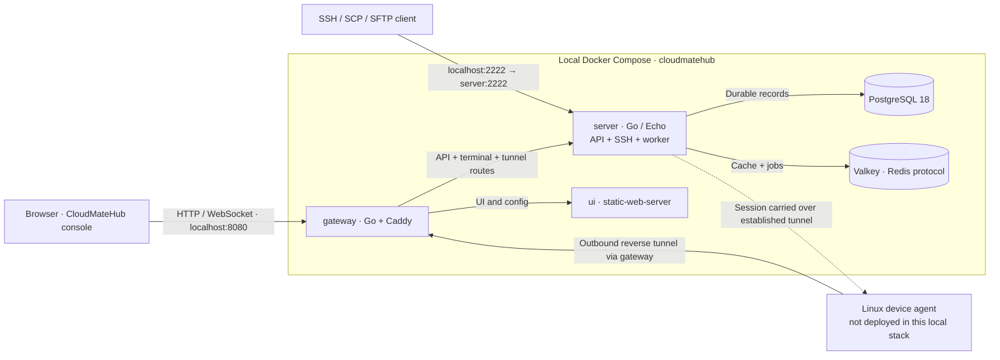

# CloudMateHub

A self-hosted workspace for remote Linux device access, built on **ShellHub Community v0.27.0**. CloudMateHub adds its own identity, teal/slate visual system, responsive sign-in/setup layouts and console styling while retaining the upstream API and agent compatibility.

## Run locally

Requires Docker Desktop on this Mac, or Docker Engine + Compose on Ubuntu.

```sh
./deployments/cloudmatehub build
./deployments/cloudmatehub start
./deployments/cloudmatehub status
./deployments/cloudmatehub stop
```

The default local configuration opens **http://localhost:8080**, with SSH at **localhost:2222**, bound to loopback. For LAN access, set both `SHELLHUB_BIND_ADDRESS` and `SHELLHUB_DOMAIN` in the ignored `.env.override` to the Mac’s LAN IPv4 address, then run `./deployments/cloudmatehub start`. Open `http://<LAN-IP>:8080`; SSH uses `<LAN-IP>:2222`. The gateway accepts the configured host, so use that IP after switching. Update both values if the LAN address changes. `stop` preserves application data.

Project-owned product copy, npm workspaces (`@cloudmatehub/*`), icon/theme assets, and deployment commands use CloudMateHub. `deployments/shellhub` remains an alias. Upstream licenses, source attribution, published dependency/image addresses, Go module imports, `SHELLHUB_*` configuration, agent executable names and device authentication wire formats, existing browser storage keys, remain compatible with existing installations. The active Compose project is `cloudmatehub`; previous data volumes are reused during migration.

## Architecture picture


[Scalable SVG](docs/architecture/assets/cloudmatehub-architecture.svg) · [Mermaid source](docs/architecture/overview.mmd)



The browser reaches the gateway, which serves the UI and forwards API/terminal/tunnel requests to the Go server. Native SSH clients connect directly to the server's published SSH port. The device agent initiates an outbound reverse connection; it is not an extra service in the default local stack.

The server owns **API + authorization + SSH/tunnel/session coordination + an in-process Asynq worker**. PostgreSQL stores durable records; Valkey supplies a Redis-compatible cache and queue. A separate worker or OpenAPI container is not part of this local production stack.

## Source layout

| Path | Responsibility |
| --- | --- |
| `ui/apps/console` | React/TypeScript console; hooks, stores, pages and browser terminal |
| `ui/packages/design-system` | Shared primitives; console overrides provide CloudMateHub styling |
| `server/api/routes`, `services`, `store/pg` | HTTP adapters → business operations → PostgreSQL |
| `server/ssh`, `server/app` | SSH/tunnels/session lifecycle and process composition |
| `gateway` | Go/Caddy HTTP routing and optional TLS |
| `agent` | Managed-host agent; device identity and outbound tunnels |
| `pkg` | Shared models, API, cache and job contracts |
| `openapi` | API specification and build-time client generation |
| `deployments` | Source-build overrides, platform examples and checks |
| `docs/architecture` | Detailed architecture notes, diagrams and cleanup policy |

## Read the architecture

- [System overview](docs/architecture/01%20System%20Overview.md)
- [Console and design](docs/architecture/02%20Console%20and%20Design.md)
- [Server and domain](docs/architecture/03%20Server%20and%20Domain.md)
- [Gateway and connections](docs/architecture/04%20Gateway%20and%20Connections.md)
- [Device agent](docs/architecture/05%20Device%20Agent.md)
- [Data and trust](docs/architecture/06%20Data%20and%20Trust.md)
- [Development and deployment](docs/architecture/07%20Development%20and%20Deployment.md)

**Obsidian:** open the `CloudMateHub` vault at `../CloudMateHub/CloudMateHub`, then open `CloudMateHub Architecture.md` or `CloudMateHub Architecture.canvas`. The vault includes linked notes for Graph view, editable canvas connections, Mermaid diagrams and PNG/SVG attachments.

## VPN / WireGuard

**VPN → WireGuard** adds personal `.conf` downloads/QR codes, instance-admin peer assignment, and integrated **WGDashboard 4.3.4** management sections. Hub instance admins use their existing Hub sign-in; there is no separate WGDashboard login panel. WireGuard management tabs exclude monitoring navigation. Ordinary users receive only their assigned configurations; management is checked on the backend. Namespace admin roles alone do not grant instance management.

[Integration, upstream feature coverage and Ubuntu requirements](integrations/wgdashboard/README.md).

This is local management preparation: a reachable Ubuntu host and VPN endpoint are still required. No public management or VPN UDP port is enabled on this Mac. Unassigning a download does not revoke an already-installed peer; restrict/delete the peer in administration to revoke its network access.

The diagram above describes the base device-access stack. The current deployment adds two internal containers: the VPN broker and WGDashboard, with separate persistent state. API/SSH/worker ownership in the existing server is unchanged.

## Data and feature changes

After each feature, remove **only the test/demo fixtures that the feature created and explicitly owns**. Preserve real accounts, devices, settings, sessions, keys, browser state and Docker volumes. Do not use a database reset or `down -v` as cleanup. Record fixture IDs and cleanup results; if no persistent fixtures were created, no cleanup is needed.

See [project instructions](AGENTS.md) and [test/demo data policy](docs/architecture/TEST-DATA-POLICY.md). The branding/SSH-link verification created one owned, unapproved temporary SSH request; its key files and expired approval were removed through local teardown and the normal cleanup job. See the [verification and cleanup report](docs/verification/2026-11-03-branding-ssh-approval.md).

## Deployment and current limits

[Deployment instructions](deployments/README.md) cover the existing source-build setup. Separate `deployments/macos` and `deployments/ubuntu` directories hold platform notes/examples. Remote Ubuntu deployment needs the actual host, DNS/TLS and firewall configuration. The local agent is not automatically installed or enrolled.

The production build and type checking passed. The latest checks passed **2,772 console tests**, **247 design-system tests**, **117 website tests**, **47 documentation tests**, and the relevant backend/shared API/SSH suites, including installed-agent authentication compatibility. Live verification covered the unknown-key browser link and a real enrolled-key SSH command. Interactive web-terminal/SCP/SFTP workflows, a complete security audit, and the full upstream integration suite remain unverified. Cloud/Enterprise-only backend extensions are not added by this customization.

## Upstream and license

Based on [ShellHub](https://github.com/shellhub-io/shellhub), release `v0.27.0`, commit `fdcc51e4fdad55440b8cfa3061b2729a50deea7b`. Original source is developed by O.S. Systems and contributors. The [Apache-2.0 license](LICENSE.md) and upstream attribution remain intact. The original README is preserved in [docs/upstream/README.shellhub.md](docs/upstream/README.shellhub.md).

[CloudMateHub customization notes](CLOUDMATEHUB.md) · [Security policy](SECURITY.md)

## Native SSH identification links

When an unknown SSH key connects, the terminal’s approval link includes the published HTTP/HTTPS port (`SHELLHUB_HTTP_PORT` or `SHELLHUB_HTTPS_PORT`). For example, HTTP on port 8080 produces `http://<LAN-IP>:8080/ssh-identities/new/<code>`. After signing in, the browser returns to that approval page, including when a previous session expired. Add the key only if you started the connection, then enter the browser’s confirmation code in the waiting terminal. Approval requests expire after 90 seconds; restart SSH for a fresh link if needed. The browser-port correction leaves token issuers and existing identities unchanged.

Native keyboard-interactive prompts use `cloudmatehub-approval` and `cloudmatehub-approval-denied`. The server and browser terminal bridge share these names; existing device key signatures and signing keys remain unchanged.

SSH welcome announcements are saved per namespace. Updating the default in source does not rewrite existing saved announcements. The current namespace’s saved welcome message was backed up and explicitly updated to CloudMateHub; upstream attribution remains in this repository.

## HTTPS & Certificates

Instance admins can open **Settings → HTTPS & Certificates** to validate PEM certificates, test HTTPS on a candidate address, confirm within 60 seconds, or restore the previous certificate. Invalid candidates leave the current dashboard untouched. Unconfirmed or interrupted activations roll back automatically. The recovery page is independent of Caddy and published only at `http://localhost:9080`; run `./deployments/cloudmatehub recovery` on the server for its private access link. Private-key uploads are allowed only over trusted HTTPS or through local recovery/SSH tunneling. Never share that recovery link or commit HTTPS state.

The deployment now has eight services: the original five, the two VPN services, and the HTTPS controller. HTTP 8080 and HTTPS 8443 reach the controller, which forwards application traffic to the internal Caddy gateway. The candidate HTTPS port defaults to 9443 (`CLOUDMATEHUB_HTTPS_TRIAL_PORT`); a browser must reach it to confirm activation. Confirmed sites redirect HTTP to HTTPS. Until you supply and confirm a matching certificate, the existing HTTP dashboard remains active. Private CAs require browser and device-agent trust to be installed separately.

[HTTPS architecture, recovery, backup requirements and limitations](docs/architecture/09%20HTTPS%20and%20Recovery.md). Automatic certificate issuance/renewal is a later phase.

## Session recordings and storage

Every new SSH shell or command connection is recorded on the server, including native terminal connections and commands without a PTY. Open **Sessions** to play or download a recording, and select a channel for multiplexed connections. SFTP file contents and raw input keystrokes are excluded.

Instance admins can open **Settings → Storage & Recordings** to select local disk, an operator-mounted NFS share, or an HTTPS S3-compatible bucket. Destinations are verified before saving. Completed archives use the selected storage; PostgreSQL retains captured output as a recovery copy. Failed archive writes retry automatically, and previous recordings remain accessible after storage changes. New S3 credentials require trusted HTTPS.

[Recording architecture, host disk/NFS setup, backup requirements and limits](docs/architecture/10%20Session%20Recording%20and%20Storage.md). The new `recording-state` and `recording-files` volumes must be included in backups. Existing real data and storage volumes are preserved.

## Active Directory, OpenLDAP and User Management

Instance admins can open **Settings → Directory connections** to configure Active Directory and OpenLDAP independently, test the encrypted connection, and check a user sign-in without creating an account. Both directories can be enabled together. The separate **User Management** tab lists Local, Active Directory and OpenLDAP accounts and creates local members; use **Team** for namespace access.

Activate trusted HTTPS before entering directory or new-account passwords. Directory connections require LDAPS or mandatory StartTLS, verified certificates and an optional private CA. Local administrator sign-in stays available. Directory account creation on first sign-in is an explicit option; new accounts get no admin privileges or device access. Accounts are matched by permanent directory ID, never merged by email. Disabled AD accounts and required-group restrictions are checked at login and periodically while using Hub tokens.

Back up the new `directory-state` volume privately alongside PostgreSQL. It contains encrypted connection settings and their encryption key. No real directory is configured automatically. [Connection setup, identity flow and operational limits](docs/architecture/11%20Directory%20Authentication%20and%20Users.md).

WireGuard administration preserves same-origin referrers so embedded connection and peer creation also works in browsers without Fetch Metadata headers. Hub admin authorization and cross-origin request protection remain enforced.

## Client browser SSH console

Clients can open **SSH → Browser Console** (`/console`), choose an online accepted device, and select **Open console**. The existing connection dialog handles Linux usernames, browser SSH identities, or legacy device credentials. Open terminals can be resumed and stay connected while navigating the dashboard. Offline devices cannot be opened.

Operator, Administrator or Owner namespace access is required. SSH identities and access policies continue to control device access; a Hub account or WireGuard assignment alone does not grant a shell. Namespaces using browser SSH keys require trusted HTTPS (or localhost) and a browser with Ed25519 WebCrypto and IndexedDB support. Sessions use the existing recorded SSH bridge.

Temporary dashboard sample devices, when requested, are clearly named `demo-*` and tracked by exact fixture ownership. See [the requested demo-data notes](docs/verification/2026-11-04-requested-demo-data.md) for the current examples and cleanup boundaries. They do not grant additional user access or change production SSH policies.

CloudMateHub deployment uses the `cloudmatehub` Compose project and locally built `cloudmatehub/server:local`, `cloudmatehub/ui:local`, and `cloudmatehub/gateway:local` images. Core application builds require no published ShellHub application images. Standard infrastructure and WGDashboard dependencies retain their upstream attribution. Existing installations may set `CLOUDMATEHUB_VOLUME_PREFIX` and `CLOUDMATEHUB_EXISTING_VOLUMES=true` to reuse their original data volumes; preserve signing keys and never reset volumes during migration.

## Deploy on Linux with Docker Hub images

Follow the [Ubuntu deployment guide](deployments/ubuntu/README.md) for a fresh installation or an upgrade.

The Docker Hub deployment override selects `hamid001/cloudmatehub-server`, `cloudmatehub-ui`, `cloudmatehub-gateway`, `cloudmatehub-https-manager` and `cloudmatehub-wgdashboard`. VPN broker and WGDashboard use the same WireGuard integration image. It removes local build definitions. Registry publication must complete before these commands can succeed.

Add to the server's private `.env.override`:

```dotenv
CLOUDMATEHUB_IMAGE_COMPOSE_FILE=deployments/compose.dockerhub.yml
CLOUDMATEHUB_DOCKERHUB_NAMESPACE=hamid001
CLOUDMATEHUB_IMAGE_TAG=2026.11.05-9a6b015f8
```

Then run:

```sh
./bin/docker-compose pull
./deployments/cloudmatehub start
```

Use the versioned tag for repeatable deployment. `latest` tracks the newest published build. Preserve existing signing keys, `.env.override` and data volumes. Fresh servers still need their normal configuration and initial administrator setup. Standard PostgreSQL/Valkey images are pulled separately. Images contain application code, not your local database, accounts, certificates or recordings. Private repositories require `docker login` on the destination server.

To publish a subsequent release after `docker login`, run `python3 deployments/publish-dockerhub.py hamid001 --tag <release-tag>`. The script publishes the five production images for AMD64 and ARM64 using Docker credential storage. `--dry-run` displays destinations without uploading. Do not enable the pull-only image override on the build machine.
