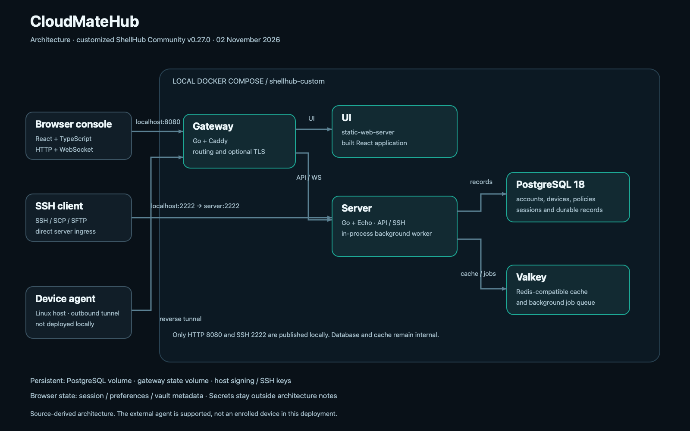
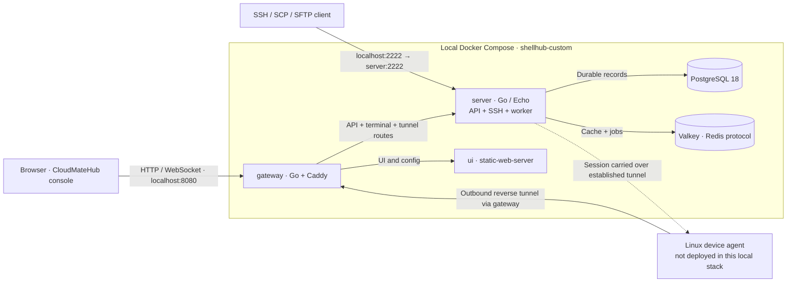

# System overview

CloudMateHub is a customized remote-device workspace built on **ShellHub Community v0.27.0**, commit `fdcc51e4fdad55440b8cfa3061b2729a50deea7b`. The current customization redesigns the console identity, public screens, navigation styling, and product copy. It retains the upstream Go backend and agent protocols.

## Runtime picture

The original device-access core has **five containers**. The VPN extension adds a broker and WGDashboard, making **seven containers**. See [VPN architecture](../../integrations/wgdashboard/README.md). The picture above shows the original core. In particular, API handling, SSH ingress, tunnel/session coordination, and background jobs run in the **same server process**.

## Responsibilities

| Component | Responsibility | Runs locally? |
| --- | --- | --- |
| Browser | React UI, input validation, navigation, terminal rendering | Yes, on the user's computer |
| UI container | Serves the compiled console and runtime config | Yes |
| Gateway | Caddy-based HTTP routing and optional TLS | Yes |
| Server | API, authorization, SSH ingress, reverse tunnels, sessions, jobs | Yes |
| PostgreSQL | Durable application records | Yes |
| Valkey | Redis-compatible cache and background queue | Yes |
| Device agent | Maintains outbound connectivity and handles sessions on a managed host | Not part of the default local stack |

## Scope and evidence

These notes describe the source and the checked-in Compose configuration as of **2026-11-02**. Earlier checks built all three application images and exercised service health. The CloudMateHub UI build/typecheck and 102 selected tests passed. This does not establish a real device enrollment or an authenticated end-to-end SSH session.

The public Community source is the baseline. Cloud/Enterprise-only backend extensions are not included merely because their UI labels or extension hooks exist.

Continue with [02 Console and Design](02%20Console%20and%20Design.md), [03 Server and Domain](03%20Server%20and%20Domain.md), [04 Gateway and Connections](04%20Gateway%20and%20Connections.md), [05 Device Agent](05%20Device%20Agent.md), [06 Data and Trust](06%20Data%20and%20Trust.md), and [07 Development and Deployment](07%20Development%20and%20Deployment.md).
