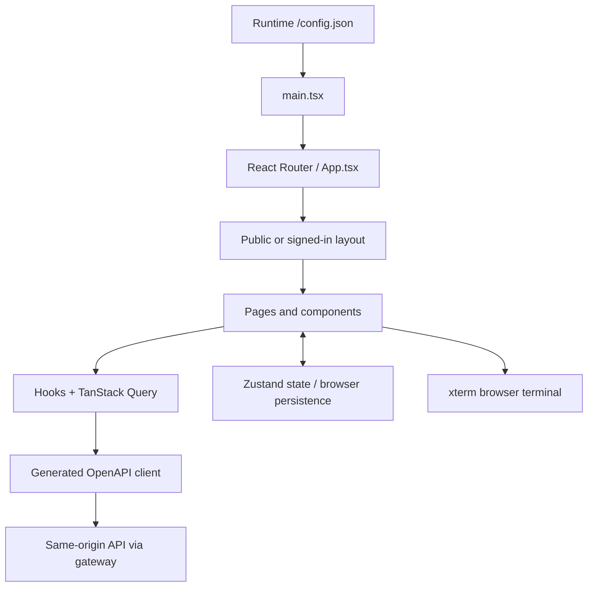

# Console and design

The user-facing application lives in `ui/apps/console`. It is a **React + TypeScript** SPA built by Vite. Production does not run a Vite development server: a `static-web-server` container serves the compiled assets.

## Main layers

- **Pages and components:** user journeys such as login, setup, device inventory, sessions, access policies and account settings.
- **Hooks / TanStack Query:** requests, loading/error handling and server-state caching.
- **Zustand stores:** local session/UI state and preferences. Browser state is separate from PostgreSQL records.
- **OpenAPI client:** generated during the UI build from the bundled API specification. Its base URL is the console's origin; the gateway routes API requests.
- **Design system:** shared primitives under `ui/packages/design-system`, with console-specific Tailwind/CSS overrides.
- **Terminal:** xterm renders terminal interaction; actual authorization and session transport belong to the server/agent.

## CloudMateHub changes

`BrandLogo.tsx` draws the cloud/terminal mark and wordmark. `BrandStory.tsx` provides the welcome illustration and introduction. `AuthLayout.tsx` and `FirstRunLayout.tsx` provide responsive layouts; `SidebarShell.tsx` controls navigation sizing. `index.css` and `tailwind.config.js` define the teal/slate treatment. The SVG favicon is `public/cloudmatehub.svg`.

Visible copy uses CloudMateHub. Package imports, browser-storage keys, API routes and webhook protocol names retain compatibility. Existing built-in terminal-theme selections are normalized to the new display names. The upstream marketing survey is disabled through deployment configuration.

The UI does **not** talk directly to PostgreSQL or Valkey. Hiding a button is not authorization: backend checks remain the security boundary.

Related: [03 Server and Domain](03%20Server%20and%20Domain.md), [06 Data and Trust](06%20Data%20and%20Trust.md), [07 Development and Deployment](07%20Development%20and%20Deployment.md).

## Branding and compatibility

Owned UI copy, npm workspaces, icon symbols, theme assets and documentation use CloudMateHub. Published upstream links and legal attribution remain original. Persisted session/vault/browser-key identifiers retain their legacy values so existing accounts, preferences and encrypted vaults remain readable. The native SSH approval destination survives both initial sign-in and expired-token recovery.

## Client Browser Console

`/console`, linked as SSH → Browser Console for namespace members, provides accepted-device discovery, search/pagination, online state, a direct browser connection dialog and current-namespace terminal resumption. It reuses `useDevices`, `ConnectModal`, the in-memory terminal store and `TerminalManager` rather than a separate SSH implementation. Operators and higher roles may connect; observers receive an access explanation and do not fetch console targets. Device-selection state resets on user/namespace changes. Only terminals explicitly owned by the current namespace appear in the resume list.

New-identity namespaces require a secure browser context for WebCrypto keys; the page explains HTTPS setup and prevents an unsupported plaintext browser-key connection. Credentials remain under the existing connection flow; the page stores no new passwords, keys or persistent fixtures. Existing terminals remain recorded by the shared server relay.
