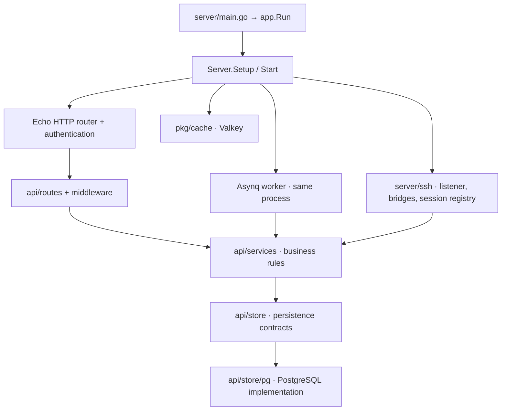

# Server and domain

`server/main.go` delegates to `server/app`. The application composes HTTP, persistence, cache, business services, background jobs, SSH and tunnel handling.

## Ownership

- **Routes and middleware** bind/validate requests, establish request context, enforce access boundaries and encode responses.
- **Services** own domain operations, including users, namespaces, devices, provisioning, policies and sessions.
- **Store contracts** separate services from PostgreSQL details; `store/pg` provides SQL persistence and migrations.
- **SSH subsystem** connects incoming clients with authenticated devices through managed reverse connections. The live session registry is process memory, not a separate container.
- **Worker subsystem** is created and started by the server. Scheduled maintenance includes device/session/approval and ephemeral-record cleanup. It is not the same thing as our feature-test cleanup policy.

## Source map

| Path | Meaning |
| --- | --- |
| `server/app/server.go` | Composition, store setup/migrations, worker registration, HTTP and SSH startup |
| `server/api/routes/` | API adapters and middleware |
| `server/api/services/` | Application/domain behavior |
| `server/api/store/` | Persistence interfaces |
| `server/api/store/pg/` | PostgreSQL adapters and migrations |
| `server/ssh/` | HTTP bridges, SSH server, sessions and dialer |
| `pkg/models/`, `pkg/api/`, `pkg/worker/` | Shared contracts, models and job abstractions |

For a new feature, follow its ownership: specification → backend validation/service/store if needed → generated client → hooks → UI. A frontend-only visual change should not require a database migration.

Related: [04 Gateway and Connections](04%20Gateway%20and%20Connections.md), [06 Data and Trust](06%20Data%20and%20Trust.md), [07 Development and Deployment](07%20Development%20and%20Deployment.md).
