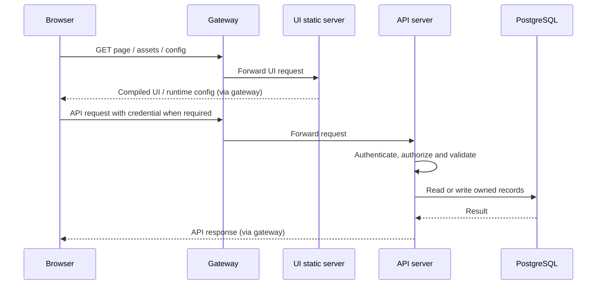

# Gateway and connections

The `gateway` container is **Go + Caddy**, configured from environment variables and `gateway/Caddyfile.tmpl`. It routes browser/API/agent traffic. Authentication and application authorization remain inside the server.

## Local entry points

| Entry | Host endpoint | Destination |
| --- | --- | --- |
| Browser and HTTP API | `http://localhost:8080` | Gateway port 80, then UI or server |
| SSH / SCP / SFTP | `localhost:2222` | Server port 2222 directly; bypasses HTTP gateway |
| Database | No host port published | `postgres:5432` inside Compose |
| Redis protocol | No host port published | `redis:6379` inside Compose (Valkey image) |

The table shows the loopback defaults. For LAN deployment, set `SHELLHUB_BIND_ADDRESS` and `SHELLHUB_DOMAIN` in the ignored `.env.override` to the host’s LAN IPv4 address and recreate services with `./deployments/cloudmatehub start`. HTTP and SSH then bind to that interface on ports 8080 and 2222. Use the configured IP in browser and agent URLs; update both values when it changes. The gateway rejects unconfigured Host headers. The `redis` service name is a compatibility name, not a separate Redis installation.

## Typical browser request

## Device sessions

The device initiates a reverse connection through the HTTP gateway to the server. A user then connects through either the web terminal or the direct SSH listener. The server evaluates access and uses the established device tunnel to carry the session. It does not need a new public inbound port on each managed device.

Supported transport paths include legacy `/ssh/connection` and newer `/agent/connection`. Transport details and fallbacks are version-dependent; do not treat every connection as an ordinary browser WebSocket.

TLS is supported by the gateway, but automatic TLS is **disabled in the current localhost setup**. Local HTTP is not a production Internet deployment. Remote Ubuntu deployment needs an intentional hostname/interface, TLS and firewall configuration.

Related: [05 Device Agent](05%20Device%20Agent.md), [06 Data and Trust](06%20Data%20and%20Trust.md), [07 Development and Deployment](07%20Development%20and%20Deployment.md).

## Native SSH → browser approval

The server receives the public HTTP and HTTPS ports from Compose. `Server.consoleHost` adds the active nonstandard port before configuring the SSH session banners, while `instanceIssuer` keeps its established value. Unknown-key and reauthentication links therefore point to the browser’s actual listener rather than silently using port 80. Signed-out users and expired sessions retain the complete approval destination through login; the existing safe redirect validation still limits navigation to this app. No authorization rule is bypassed, and approval codes remain short-lived.

The keyboard-interactive challenge titles visible in native SSH are `cloudmatehub-approval` and `cloudmatehub-approval-denied`. The web terminal bridge reads the same constants within the server binary, so rebuilding the server updates both paths together. This changes prompt titles, not the device authentication signing format.

Post-login welcome text comes from `Namespace.Settings.ConnectionAnnouncement` in PostgreSQL, read by `Session.Announce`. `envs.AnnouncementFor` supplies the default only when creating namespaces. Rebranding an existing installation therefore requires an explicit, scoped saved-announcement update as well as changing the default. Custom announcements must be preserved unless their replacement is requested.

The managed deployment now places an independent HTTPS controller before Caddy. Public ports 8080/8443 belong to the controller; Caddy remains internal. Candidate confirmation uses 9443, and recovery is host-loopback-only on 9080. See [09 HTTPS and Recovery](09%20HTTPS%20and%20Recovery.md).

Server-side SSH recording and admin-selected local/NFS/S3 archive storage are described in [[10 Session Recording and Storage]]. PostgreSQL retains a recovery copy; destination changes preserve existing recordings.

## Client console entry point

Clients discover devices under SSH → Browser Console (`/console`). Accepted-device listing stays namespace scoped and the page reuses the existing browser SSH connection dialog. The existing authenticated POST `/ws/ssh/session` enforces DeviceConnect and namespace/device matching; its single-use WebSocket handoff opens `/ws/ssh`. Existing SSH identity/access-policy checks and shared recording apply. No new anonymous API, direct arbitrary-host SSH gateway or elevated member role is introduced. Current-namespace terminals can be resumed from the page without creating a second connection. HTTPS is needed for browser-key identities on non-localhost addresses.
