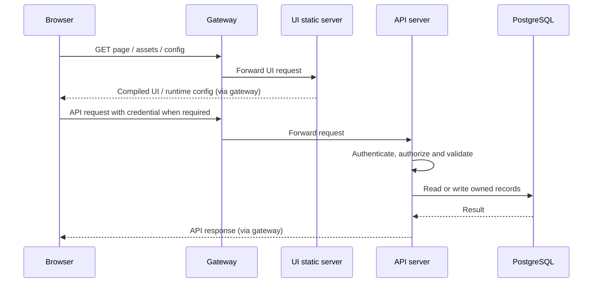

# Gateway and connections

The `gateway` container is **Go + Caddy**, configured from environment variables and `gateway/Caddyfile.tmpl`. It routes browser/API/agent traffic. Authentication and application authorization remain inside the server.

## Local entry points

| Entry | Host endpoint | Destination |
| --- | --- | --- |
| Browser and HTTP API | `http://localhost:8080` | Gateway port 80, then UI or server |
| SSH / SCP / SFTP | `localhost:2222` | Server port 2222 directly; bypasses HTTP gateway |
| Database | No host port published | `postgres:5432` inside Compose |
| Redis protocol | No host port published | `redis:6379` inside Compose (Valkey image) |

Use the configured hostname `localhost`; an unconfigured Host such as `127.0.0.1` was observed returning 404. The `redis` service name is a compatibility name, not a separate Redis installation.

## Typical browser request

## Device sessions

The device initiates a reverse connection through the HTTP gateway to the server. A user then connects through either the web terminal or the direct SSH listener. The server evaluates access and uses the established device tunnel to carry the session. It does not need a new public inbound port on each managed device.

Supported transport paths include legacy `/ssh/connection` and newer `/agent/connection`. Transport details and fallbacks are version-dependent; do not treat every connection as an ordinary browser WebSocket.

TLS is supported by the gateway, but automatic TLS is **disabled in the current localhost setup**. Local HTTP is not a production Internet deployment. Remote Ubuntu deployment needs an intentional hostname/interface, TLS and firewall configuration.

Related: [05 Device Agent](05%20Device%20Agent.md), [06 Data and Trust](06%20Data%20and%20Trust.md), [07 Development and Deployment](07%20Development%20and%20Deployment.md).
