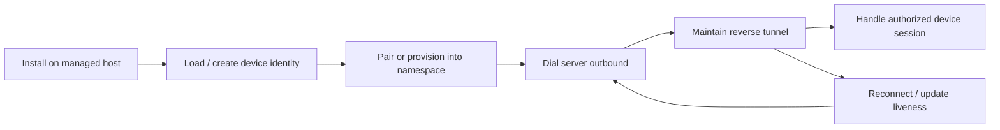

# Device agent

The agent is an application running on the managed host, separate from the five-container control stack. Its source lives in `agent/`; `agent/pkg/agentd` owns configuration, authentication, device state and reverse-tunnel lifecycle.

## Lifecycle

Configuration includes the server address, device private-key path and tenant/namespace association. The current agent code supports legacy reverse dialing and a newer multiplexed transport. Device OS authentication and system information helpers live under `agent/pkg/osauth` and `agent/pkg/sysinfo`.

A browser login is not a device installation. Running the control stack on a Mac does not enroll that Mac as a managed Linux host. The default production Compose configuration does not start a sample agent. Development/test agent Compose files are separate and are not implicitly active.

Before a real device can reach this server, its address must be reachable from that device. `localhost` on a remote Ubuntu host refers to that host, not this Mac. Avoid copying private device keys into the Obsidian vault or Git.

No real device enrollment or interactive SSH/SCP/SFTP session is claimed by these notes.

Related: [04 Gateway and Connections](04%20Gateway%20and%20Connections.md), [06 Data and Trust](06%20Data%20and%20Trust.md).
