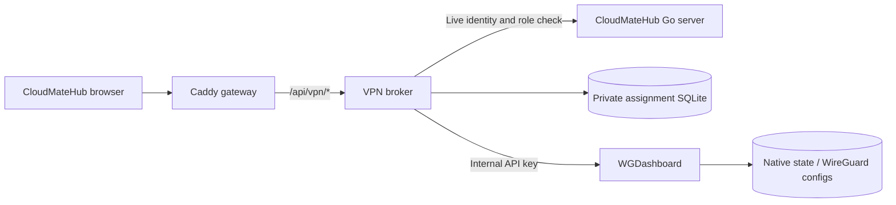
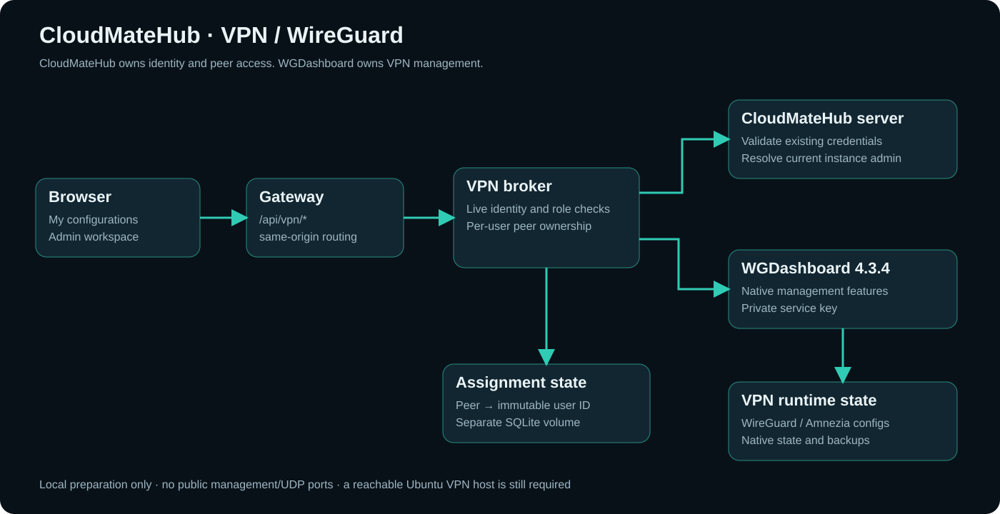

# VPN and WireGuard

CloudMateHub adds **VPN → WireGuard**, backed by pinned **WGDashboard 4.3.4**. The full native administration workspace is embedded for instance admins; ordinary users get only their assigned `.conf` files and QR codes.

## Access model

- Instance admins can configure interfaces/peers and use native WGDashboard management features.
- An admin assigns an existing peer to an existing CloudMateHub user ID. A peer has only one owner.
- Users can list and download only their own assigned peers. They cannot browse server keys or open the native dashboard.
- The broker revalidates CloudMateHub credentials/admin status per request. Iframe access uses a short-lived HttpOnly SameSite cookie with same-origin checks.
- The service API key stays server-side. No raw credential value belongs in this vault.

**Unassigning removes download access, not an installed VPN credential.** Restrict/delete the peer in native management to revoke network access.

## Deployment and state

The current Compose stack has **seven containers**: the original five plus `vpn-broker` and `wgdashboard`. The dashboard is internal-only; no host management/UDP VPN port is published. NET_ADMIN is restricted to its container namespace, with no host-network or Docker-socket access. Assignment records, native WGDashboard state and WireGuard configuration files use separate volumes.

This prepares local management; it is not a verified remote VPN. A reachable Ubuntu host, public/internal endpoint, subnets/DNS, routing/NAT, firewall/UDP publication and HTTPS must be deliberately configured later. Native traffic, external email/webhooks/OIDC/sharing, diagnostics and AmneziaWG depend on their own runtime setup. Public native client/share paths remain admin-gated rather than bypassing CloudMateHub roles.

The upstream admin UI retains its configuration/peer editing, bulk operations, traffic/history, backups/restore/templates, scheduling, diagnostics, client and settings surfaces. This is not a claim that every external provider or live tunnel was exercised.

## Source

- `integrations/wgdashboard/broker.py`: live identity checks, admin proxy and user ownership.
- `integrations/wgdashboard/Dockerfile`: derived digest-pinned upstream runtime and credential-log removal.
- `integrations/wgdashboard/README.md`: complete feature coverage, limits and deployment handoff.
- `ui/apps/console/src/pages/vpn/`: CloudMateHub personal/admin views.
- `gateway/Caddyfile.tmpl`, `deployments/compose.yml`: internal routing and service topology.

Test data uses isolated temporary fixtures and is removed after checks; real application records and keys are preserved.

Related: [System overview](01%20System%20Overview.md), [Console](02%20Console%20and%20Design.md), [Connections](04%20Gateway%20and%20Connections.md), [Data](06%20Data%20and%20Trust.md), [Deployment](07%20Development%20and%20Deployment.md).
