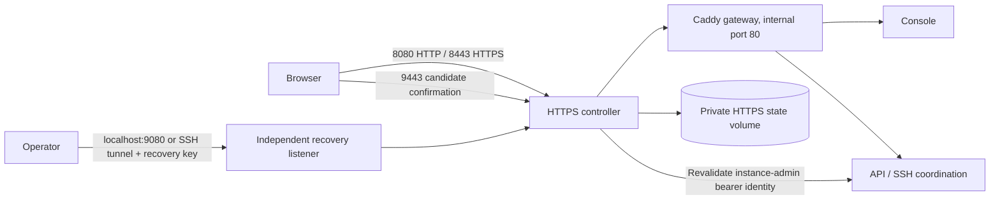

# HTTPS certificates and local recovery

The deployment adds `https-manager` in front of the existing Caddy gateway. It owns public HTTP/HTTPS, a temporary candidate HTTPS listener, and an independent server-local recovery interface. Caddy remains the application router and is no longer host-published directly.

## Workflow

1. Open **Settings → HTTPS & Certificates** as a Hub instance administrator. Members cannot call its management API.
2. Initially use server-local recovery for private-key uploads: public LAN HTTP uploads are refused. Run `./deployments/cloudmatehub recovery` on the server for its private recovery link. The link contains a capability in its URL fragment; keep it out of notes, screenshots, chat and Git. Recovery is published only on host loopback and requires both the private recovery key and same-origin CSRF protection.
3. Upload a PEM server certificate, intermediate chain, and matching private key. An optional private CA bundle can validate private chains; browsers and existing device agents must already trust that CA separately. Certificate validation checks hostname/IP SAN coverage, dates, chain, matching key, and minimum RSA size. CA signing certificates are refused as server certificates.
4. A candidate is stored separately from the active revision. Its private key is AES-GCM encrypted with a private persistent master key. Certificates and restore metadata are not browser-persisted. The browser clears the uploaded key after staging.
5. Activation probes the candidate on a temporary local TLS server and verifies dashboard/API health. Health checks release the state lock so they cannot block the current dashboard. The candidate is then exposed on the trial HTTPS port for 60 seconds; the production certificate stays unchanged.
6. Open the candidate confirmation link, check browser trust and address, and choose **Keep HTTPS**. The confirmation capability works only through the candidate TLS listener and is removed from browser history immediately. A final health probe precedes promotion.
7. Without confirmation, the watchdog clears the candidate automatically. Restarting during an activation also discards the unconfirmed candidate before serving. Confirmed HTTPS redirects public HTTP to HTTPS; rollback never silently downgrades a confirmed site to public HTTP.
8. Restore the previous valid certificate from settings or recovery. A separate atomic last-good snapshot is available if the staging state is unreadable. Local recovery can upload a new certificate even without a working main certificate or application gateway. Certificate operations do not roll back users, namespaces, device keys, sessions, or database data.

## State and access

`https-state` contains private `master.key`, `recovery.key`, `state.json`, and `last-good.json` files. Directory permissions are 0700 and file permissions 0600. Back up the entire volume in protected storage, including its master key. Losing the encryption key prevents decryption of saved TLS private keys. No key material is returned by the status endpoint or logged.

The status page shows expiry warnings within 30 days and restore history. Up to 20 validated revisions are retained. No automatic ACME issuance/renewal or external expiry notification service is included in this upload-and-recovery phase. Changing the configured hostname is a separate deployment operation; certificates must match that configured hostname/IP.

The app's bearer-session storage is origin-scoped. Users may need to sign in again after switching from HTTP to HTTPS; existing accounts and stored application records remain intact. The dedicated confirmation page does not depend on that new browser session, so the 60-second confirmation can complete without re-entering Hub credentials.

Caddy's managed deployment explicitly trusts scheme and client-IP headers from the edge; the edge overwrites incoming values. VPN proxy cookies become Secure automatically for HTTPS requests. Standalone Caddy configurations retain their previous header behavior.

## Recovery limitations

Recovery survives certificate errors and a stopped Caddy application gateway because it is a different service. It does not promise availability during host/Docker failure, loss of the HTTPS state volume/master key, or loss of operator access to the server. Full disk/database rollback is deliberately outside the certificate restore mechanism. A previous certificate that has expired or no longer validates cannot be restored; upload a current certificate locally instead.
