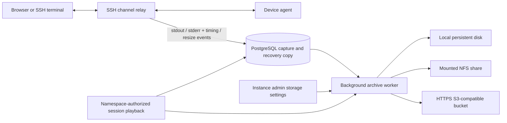

# Session recording and storage

CloudMateHub captures every SSH shell and command seat at the shared server relay, for both native-terminal and browser connections. This Community build no longer gates capture on edition or the old namespace recording switch. The connection dialog announces server recording. SFTP/subsystem and forwarding payloads are not recorded; their existing connection/request history remains available. Input keystrokes are not captured. Programs can print sensitive information to stdout/stderr, which is recorded.

## Capture and playback

The existing bounded session-event queue writes terminal stdout and stderr into PostgreSQL along with the audit timeline. Commands without a PTY are included. SFTP subsystem payloads are excluded. Commands that emit binary data are still captured as command output. Recording and event persistence still share the existing queue: database/queue exhaustion can cause incomplete recordings and is reported in server logs. This implementation favors connection availability; it is not a fail-closed compliance recorder.

Playback emits asciicast v2 with initial terminal dimensions, output timing, and resize events. Non-PTY commands use an 80×24 default. Each multiplexed SSH seat has a separate recording; Sessions and the session detail page provide a channel selector. Playback and removal use the existing namespace permissions and verify session ownership before accessing any archive. Live sessions cannot have their recording deleted. Removing a completed recording removes all its seats, retaining the session and non-output audit events.

## Storage settings

**Settings → Storage & Recordings** is available only to current instance administrators. The API inherits the server's live identity authenticator; the UI alone never grants access. A storage change writes, reads back and removes a uniquely owned probe object before becoming current. Probe identifiers and ownership are persisted before writing. Failed checks preserve the previous configuration. Probe cleanup failures retain their exact ownership manifest in `recording-state/probes/`; investigate only that named object, never bulk-delete similarly named files.

- Local disk uses the `recording-files` volume at `/recordings`; folders selected in the UI must stay beneath it. To choose a host disk, set `CLOUDMATEHUB_STORAGE_COMPOSE_FILE=deployments/compose.local-storage.example.yml` and `CLOUDMATEHUB_RECORDING_DIRECTORY` to an existing absolute host folder in the ignored `.env.override`, then restart the deployment. Existing volumes are preserved; this does not automatically move their files.
- NFS requires an operator-mounted NFS/NFS4 volume at `/mnt/recordings`. Set `CLOUDMATEHUB_STORAGE_COMPOSE_FILE=deployments/compose.nfs.example.yml`, `CLOUDMATEHUB_NFS_SERVER`, and `CLOUDMATEHUB_NFS_EXPORT` in `.env.override`, then restart. Select NFS and `/mnt/recordings` in the UI. The application checks the actual filesystem mount before using it, so a missing mount cannot silently write to a same-named local directory. The container is not granted mount privileges.
- S3 accepts an HTTPS endpoint, region, bucket, prefix and access credentials, including an optional temporary session token. Amazon S3 and compatible providers use path-style requests with signed payloads and AWS Signature V4. No TLS verification bypass or redirect forwarding is supported. The bucket must already exist. Restrict permissions to the chosen prefix, including PutObject, GetObject and DeleteObject. New secrets must be submitted through trusted HTTPS; the public HTTP page disables those fields. Rotate temporary credentials before expiration. Automatic IAM role discovery is not included.

The protocol reference is [AWS S3 single-chunk Signature V4](https://docs.aws.amazon.com/AmazonS3/latest/developerguide/sig-v4-header-based-auth.html).

## Persistence and failure recovery

The archiver scans session pages every 30 seconds and archives inactive recorded seats after a 30-second grace period for event draining. It streams output in database pages to a temporary asciicast file. Successful local writes use a temporary file, fsync and atomic rename; S3 uses a complete object PUT. An atomic manifest is written only after storage accepts the archive. Failed writes retry on later scans. Snapshot event counts and last-seen stamps detect late output or resumed connections; playback uses the newer database copy while an old archive is refreshed. A stalled archiver does not hold the lock used to change storage settings. PostgreSQL keeps its recovery copy; neither archive success nor a destination change deletes captured output automatically. Existing session retention remains opt-in and its recording pruner now removes referenced archives before the corresponding history rows.

`recording-state` at `/var/lib/cloudmatehub/recordings` contains the master encryption key, AES-GCM encrypted destination revisions, and per-seat archive manifests. Files are mode 0600 and the state directory is mode 0700. Status responses never return credentials. Keep this volume in protected backups together with PostgreSQL and recording destination data. Losing the key or manifests prevents finding/decrypting old archive destinations; the database copy remains intact and can be used after repairing the recording state.

A destination change affects future archive writes. Each completed archive retains its original destination revision, so older recordings continue to resolve. Old destination credentials remain encrypted for those reads; changes do not migrate existing archives. If an archive cannot be read, playback falls back to PostgreSQL. Settings display archive failures without logging credential-bearing URLs or raw storage errors. Recording retention defaults to disabled. An instance admin can set 1–3650 days in Storage & Recordings, or 0 to disable it. The archive sweep applies the policy to completed recordings using the session’s last activity. It removes archived objects and captured terminal output while preserving session history. The policy is stored in the encrypted recording storage state. The deployment-level session retention setting remains independent.

This storage section configures session recording archives. PostgreSQL data files, account/device metadata, WireGuard configuration, certificate keys and user files keep their existing dedicated volumes; they are not moved into an object bucket.

No persistent test fixtures were created for the retention settings change.
