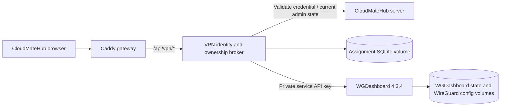

# CloudMateHub VPN / WireGuard

## Product access

The sidebar now contains **VPN → WireGuard** (`/vpn/wireguard`).

- **My configurations:** every signed-in user can view only explicitly assigned peers, download their `.conf` file or display a QR code. Configuration contents are fetched only on demand, are not put in browser storage, and responses use `no-store`.
- **Administration:** CloudMateHub **instance admins** get the embedded native WGDashboard workspace. Namespace owners/admins are not automatically instance admins.
- **User assignments:** an instance admin selects an existing CloudMateHub user and an existing WGDashboard peer. One peer has one owner. Immutable user IDs, not display names, determine access.

Create/configure an interface and peer in Administration, then assign the peer under User assignments. No automatic peer is created for every registered user: admins choose the interface and address plan. An unassigned user sees an empty state. Successful interface renames preserve peer ownership; native peer/interface deletion removes only the corresponding assignments. Failed upstream mutations do not change assignments.

**Unassigning removes configuration download access, not a configuration already installed on a device.** Restrict/delete that peer in WGDashboard when revoking its network access. A missing/deleted upstream peer makes its download fail rather than substituting another peer.

## Integration design

Pinned upstream release: **WGDashboard 4.3.4**.

- Source: https://github.com/WGDashboard/WGDashboard
- Source commit: `0018a9b1e280f8a09a63d63d32866a56047d6570`
- Official image index: `sha256:8c5b550db4fda04eff06e96af801499be485c73e0912fcf0c1031babca0f7e7b`
- Upstream Apache-2.0 license is retained in `LICENSE.upstream`.

A narrow read-only directory under `server/vpn` returns only user ID, username and name to current instance admins. It is mounted under `/internal/vpn/users`, blocked by Caddy at public ingress, and called only by the authenticated broker; it does not depend on the unavailable upstream Enterprise admin API.

The broker validates the existing bearer credential with CloudMateHub's `/api/auth/user`; it does not trust caller-supplied role or user headers. Every native-dashboard request is restricted to current instance admins. Browser iframe requests use an opaque five-minute HttpOnly SameSite=Strict cookie; credentials remain in process memory and are revalidated against CloudMateHub on every request. Role revocation is therefore effective without waiting for cookie expiry. Sessions refresh while the management tab is open, expire after inactivity, and are cleared on CloudMateHub logout.

Cookie-authenticated proxy requests require same-origin evidence, including native upstream GET endpoints that can mutate configuration. Requests never forward CloudMateHub bearer tokens or browser cookies to WGDashboard. Upstream service credentials are mounted from an ignored private file; their values are not placed in a browser URL. Native upstream API-key logging was removed in the derived image. WGDashboard's native login check is satisfied by the broker's already-validated CloudMateHub admin identity; a second WGDashboard account is not required.

`wgdashboard` has only the internal `vpn-private` network. The broker bridges that network and the app's Compose network. Neither service publishes a host management port. No host networking or Docker socket mount is used. NET_ADMIN applies only inside the WGDashboard container's network namespace. Assignment records are in a separate SQLite volume; native WGDashboard keeps its own persistent databases/configuration volumes.

## Upstream feature coverage

This embeds the original upstream administration UI and proxies its native route surface; it does not recreate a small subset and call that a full replacement.

| Feature family | Integration | Local verification / dependencies |
| --- | --- | --- |
| Interfaces, configuration creation/edit/rename/raw editor/start/stop/delete | Native admin UI | Route surface retained; real Ubuntu routing not exercised |
| Peer creation, bulk operations, keys, restrictions, updates and deletion | Native admin UI | Per-user access additionally controlled by CloudMateHub assignments |
| Client files and QR codes | Native admin UI plus CloudMateHub personal view | Ownership/IDOR and private-data UI checks tested |
| Traffic graphs, peer/session/history tracking and exports | Native admin UI | Requires actual VPN traffic for meaningful data |
| Backups, restore and templates | Native admin UI | Real backup/restore mutation not tested on user data |
| Scheduled peer jobs, quotas/expiry options and job logs | Native admin UI | Requires active host and configured jobs |
| Ping, traceroute and system status | Native admin UI | Diagnostics are restricted by the local internal-only network |
| Clients, assignment tools and profile management | Native admin UI | Native WGDashboard clients remain distinct from CloudMateHub user assignments |
| Email, sharing, webhooks, OIDC, cross-server settings, API keys, theme/language settings, plugins where supplied by upstream | Native admin UI | External providers, credentials, reachability or additional installation may be required; not end-to-end verified. Native cross-server administration does not automatically create CloudMateHub assignments on other servers |
| AmneziaWG support supplied by upstream image | Native admin UI/runtime | Not exercised locally |

The native dashboard is **admin gated**, including client/share routes behind this prefix. Public sharing, independent WGDashboard client sign-in, and external OIDC callbacks are not exposed to bypass CloudMateHub. CloudMateHub users use the personal configuration view instead. Do not interpret available upstream settings as proof that external services or a real tunnel are configured. No public anonymous route has been added for native share links.

## Local preparation and Ubuntu handoff

The current setup is **management preparation**, not a working remote VPN: no UDP VPN port is published, the service is on an internal network, and no reachable public endpoint has been configured. A default `wg0` configuration may be initialized by the upstream image, but no demo peer/user is seeded.

`./deployments/cloudmatehub start` creates a missing service secret idempotently via `deployments/prepare-vpn`. Preserve that file and the persistent volumes; do not commit them. On a fresh Ubuntu deployment, generate a new secret locally rather than copying a private developer credential.

Before a real deployment, provide the Ubuntu host/domain or public address, decide split/full tunnel routing, assign subnets/DNS, configure persistent forwarding/NAT as appropriate, and intentionally publish the chosen UDP ports. Replace `localhost` endpoints in actual peers. Give WGDashboard the required host/container networking arrangement for that deployment, and enable HTTPS plus `VPN_COOKIE_SECURE=true` on the broker. These host changes are not performed on the Mac.

Do not disable upstream authentication/API keys, alter its mounted URL prefix, delete the integration API key, or disable the internal service connection unless intentionally reconfiguring the integration. Those settings can break administration until repaired.

## Checks and cleanup

`test_broker.py` covers anonymous/forged credentials, non-admin denials, per-user filtering and IDOR, assignment validation, duplicate ownership, cookie CSRF/expiry/logout, role revocation, credential stripping and identity-service failure. Its temporary SQLite/key fixtures are removed with TemporaryDirectory teardown.

UI checks cover non-admin views, admin iframe initialization, and fetching private content only when requested. Real accounts/devices/settings/keys are retained. No persistent test users or demo peers should remain after feature checks. Removing real application data or Docker volumes is not the cleanup procedure.

## Hub sign-in and integrated sections

Hub instance-admin authentication is the only browser sign-in for WireGuard management. The broker still revalidates Hub credentials on every request; ordinary members can list/download only their own assigned configurations. The upstream service retains internal API-key authentication. Its embedded frontend removes its separate sign-in route and reports session/service failures to Hub instead. Native `requireAuthentication` is answered as false only after the broker has verified a current Hub admin.

WireGuard exposes Interfaces, Add interface, Restore, WG clients, Peer defaults, Interface settings, Webhooks, and User assignments as Hub tabs. Native navigation is hidden in the embedded editor. Monitoring/system-status/diagnostic navigation is excluded from these tabs and remains outside this management view. Native WG clients remain separate from Hub member assignments. The pinned upstream frontend adaptation fails the image build if the expected login implementation changes.

Validation: production builds, TypeScript checking, five role/navigation UI tests, 21 broker tests, and a syntax check of the patched native router passed. All deployed containers passed their existing health checks. No persistent test users, peers, assignments, or configurations were created; temporary broker fixture databases were removed by test teardown. No production cleanup was required. An authenticated native-browser visual check could not be completed because the browser retained a stale page during navigation; no claim of full browser end-to-end verification is made.

## Embedded creation compatibility repair (2026-11-03)

The broker uses `Referrer-Policy: same-origin` for the embedded editor. Its native fetches can therefore prove same-origin access using Referer in browsers that omit Origin and Fetch Metadata headers. A previous `no-referrer` policy caused authenticated administration to fail with Forbidden and prevented creation. Cross-origin referrers still receive no identifying URL; outside/lookalike/wrong-scheme origins remain refused. Current Hub administrator validation and per-user configuration ownership are unchanged.

Twenty-three broker tests passed. The live signed-in in-app browser now loads Interfaces and Add interface without a separate login or session error. An isolated, network-disabled container with temporary filesystems verified actual interface creation, peer creation, client configuration download and supported API teardown. The explicitly owned test container and disposable key were removed. No production fixtures were created. Real tunnel reachability remains a separate deployment requirement.
